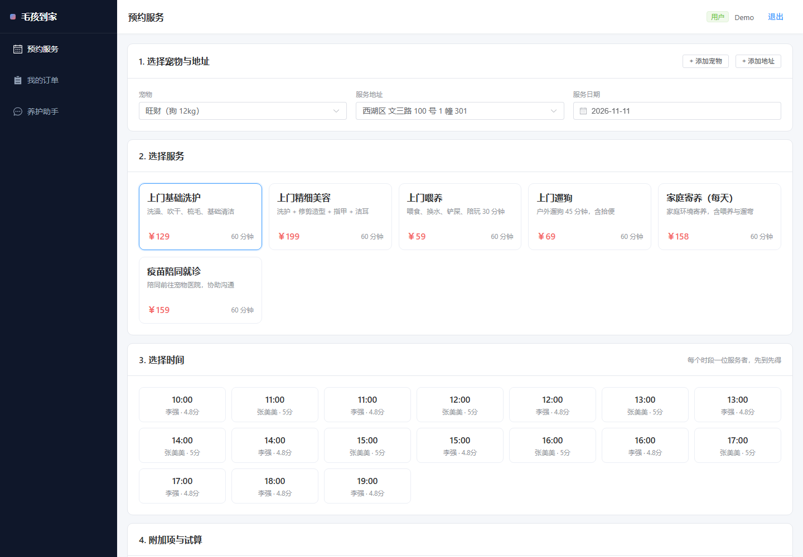
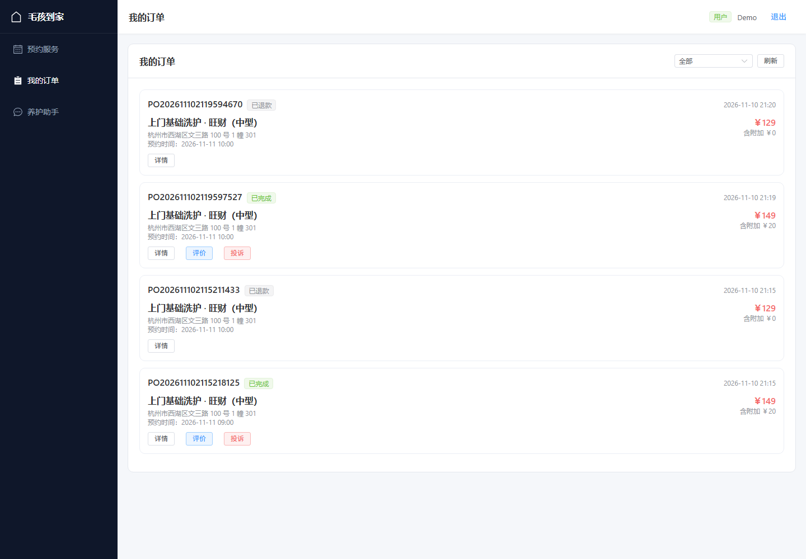
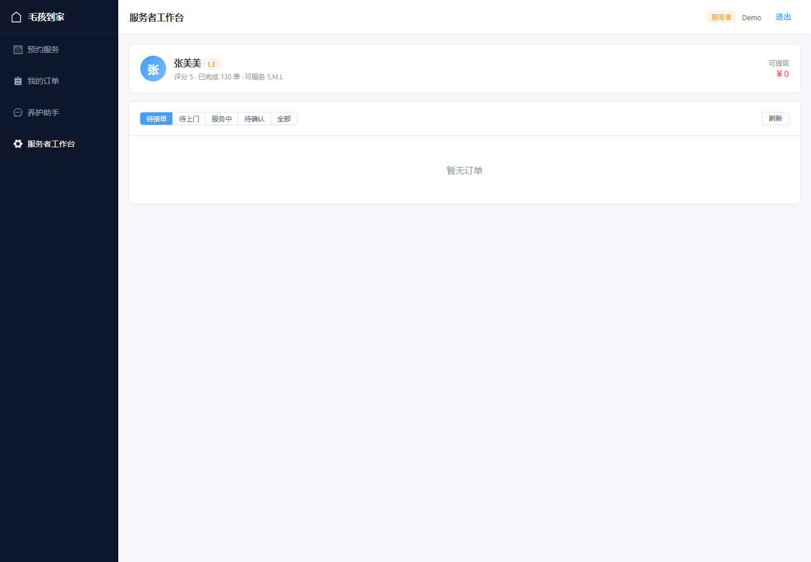
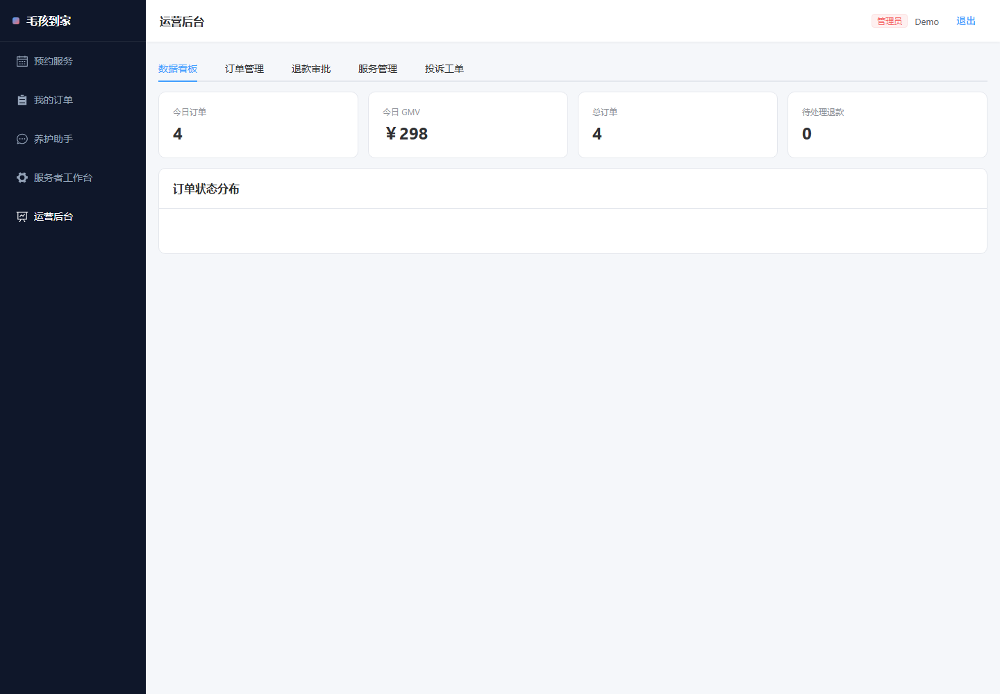
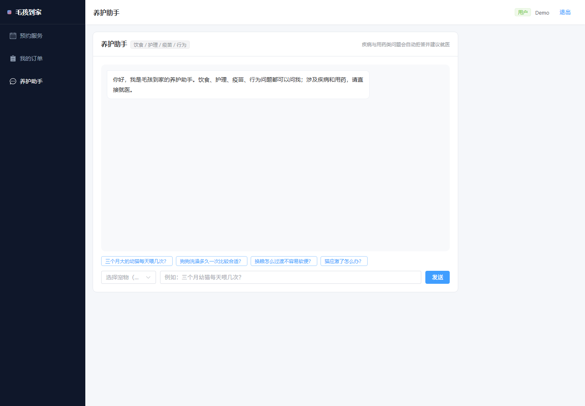
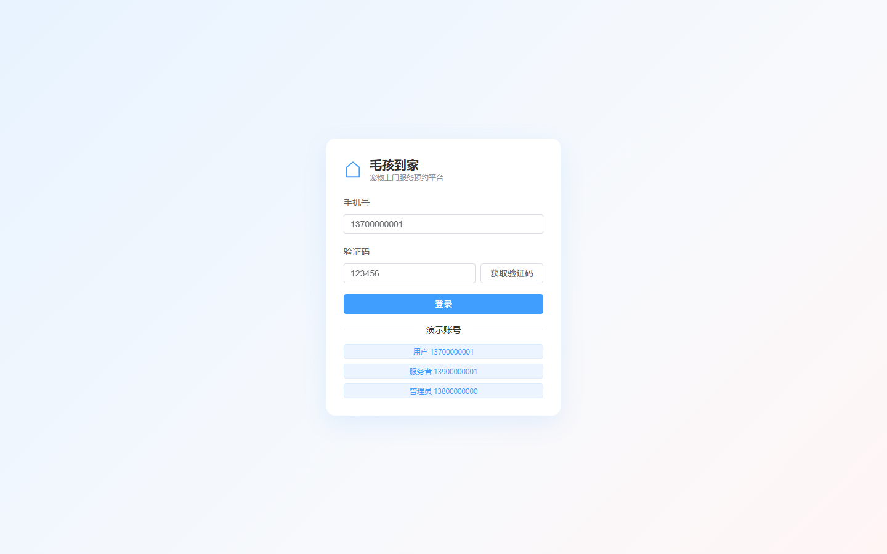

# 毛孩到家 · 宠物上门服务预约交易平台

一个面向宠物主的**上门服务预约交易系统**：选服务 → 选宠物 → 抢时间槽 → 下单 → 模拟支付 → 服务者接单 → 上门打卡 → 服务报告 → 用户确认 → 评价 → 结算，并带一个**宠物养护 AI 助手**（知识库检索 + 引用 + 拒答）。

不是功能列表堆砌，重点在两个地方：

- **交易正确性**：同一个美容师同一时段只能接一单、重复下单只生成一单、支付回调重复不重复入账。
- **AI 边界**：回答必须带知识库引用，疾病/用药类问题直接拒答并引导就医。

## 截图

| 预约下单 | 我的订单 |
|---|---|
|  |  |

| 服务者工作台 | 运营后台 |
|---|---|
|  |  |

| 养护助手 | 登录 |
|---|---|
|  |  |

## 五条端到端闭环

1. **预约**：登录 → 建宠物 → 选服务 → 选时间槽 → 试算 → 下单（锁槽）
2. **支付**：待支付 → 模拟网关 → 回调验签 → 待接单
3. **履约**：接单 → 出发 → 到达打卡 → 完成 + 服务报告 → 用户确认
4. **异常**：改约 / 取消（阶梯违约金）/ 催单（三类）/ 退款（全额/部分）/ 投诉
5. **AI**：问饮食 → 检索知识库 → 带引用回答；疾病/用药 → 拒答

## 技术栈

| 层 | 选型 |
|---|---|
| 后端 | Spring Boot 2.7.18、Java 11、MyBatis-Plus 3.5.3、MySQL 8 |
| 缓存/并发 | Redis（token、验证码）、MySQL 唯一索引 + 条件 UPDATE |
| 接口文档 | Knife4j（`/doc.html`） |
| 前端 | Vue 3、Vite 5、Element Plus、Axios |
| 部署 | Nginx、Docker Compose |
| AI | DeepSeek Chat Completions（可选）+ 自建知识库检索 |

## AI 服务化（Java + Python）

AI 层单独做成了一个 Python 服务，Java 只做网关：

```
Vue「养护助手」→ Java /api/ai/chat
                    ├─ 鉴权、限流、会话落库
                    ├─ 超时 2s/15s，失败降级到本地规则 RAG
                    └─ HTTP → Python FastAPI /agent/chat
                                ├─ 医学类问题入口拒答
                                ├─ 预检索知识库（Java 内部接口）
                                └─ LangChain Agent + 3 个工具
```

- Python 不连数据库，通过 `/internal/**` 取宠物档案、订单、知识库，接口用 `X-Internal-Token` 保护。
- 模型不可用时，Python 用检索片段拼答案；Python 不可用时，Java 走本地 RAG。两层降级，页面不会白屏。
- 代码在 `ai-service/`，启动方式见 `ai-service/README.md`。

## 架构

```
Vue3 (Nginx:8090)
   │  /api
   ▼
Spring Boot (8082)
   ├── AuthInterceptor（Redis token）
   ├── 预约域：ServiceItem / TimeSlot / Order
   ├── 交易域：PaymentOrder（模拟网关）/ RefundOrder
   ├── 履约域：ServiceRecord / Review / Complaint
   ├── 结算域：Settlement
   ├── AI 网关：/api/ai/chat、/internal/**
   └── 本地规则 RAG（降级）

        │ HTTP（X-Internal-Token）
        ▼
Python FastAPI (8000)
   └── LangChain Agent + 3 个工具 + 知识库检索

MySQL 8（petcare）    Redis（token / 验证码）
```

## 核心设计

### 1. 时间槽并发（本项目最难的点）

- 每个服务者按排班生成 60 分钟粒度的时间槽，`time_slot` 上有唯一索引 `(staff_id, slot_start)`。
- 下单时用条件更新抢占：`UPDATE time_slot SET status=1, order_id=? WHERE id=? AND status=0`，返回 1 才算抢到。
- 锁槽 15 分钟（与支付超时一致），超时未支付由定时任务释放；支付成功转 `status=2`。
- 改约 = 先锁新槽、再释放旧槽，同一事务；新槽抢不到直接失败，不会出现两个槽同时被占。

### 2. 下单幂等

- 客户端生成 `requestId`，`orders.request_id` 唯一索引。
- 重复提交先查 `requestId`，命中直接返回原订单；并发下靠唯一索引兜底。

### 3. 支付（模拟网关，但流程是真的）

- 业务订单与支付单分离，一个订单可多次支付（补差价场景）。
- 回调流程：**验签 → 金额校验 → 幂等判断 → 更新支付单 → 更新订单 → 确认时间槽 → 发通知**。
- 签名：`md5(payNo|amount|status|secret)`，金额与支付单不一致直接拒绝。
- 重复回调：支付单已是 SUCCESS 时直接返回 `idempotent=true`，不重复改订单。
- 超时未支付：定时任务关单并释放时间槽。

> 个人项目没有商户号，所以用模拟网关；但验签、幂等、金额校验、超时关单都是按真实支付写的。README 里明确写“模拟”，不冒充微信/支付宝。

### 4. 订单状态机

```
待支付(0) ──支付成功──▶ 待接单(2) ──接单──▶ 待上门(3) ──出发──▶ 服务中(4)
   │                        │                                   │
   │                        └──改约/取消                         └──完成──▶ 待确认(5) ──确认/24h──▶ 已完成(6)
   └──超时未支付──▶ 已关闭(10)

已支付订单取消 ──▶ 退款中(8) ──审批通过──▶ 已退款(9)
```

所有状态变更写 `order_status_log`，详情页可回放。

### 5. 取消与改约

- 取消违约金：服务开始前 ≥24h 全额退；2–24h 扣 20%；<2h 扣 50%；服务开始后只能走售后。
- 改约：每单 1 次、服务前 4 小时以上；换服务者时订单回到「待接单」。
- 退款单独立，需管理员审批；审批通过订单转「已退款」。

### 6. 催单

- 三类：催接单（待接单）、催上门（待上门）、催完成（服务中）。
- 每类最多 3 次、间隔 10 分钟，写订单字段 + 通知服务者；超过 3 次提示平台介入。

### 7. 结算

- 订单完成生成结算单：平台抽成 15%，服务者收入 = 实付 − 抽成。
- T+7 转「可提现」（本期不做提现打款，只展示金额构成）。

### 8. AI 养护助手（两层）

**Python Agent 层（优先）**

- `ai-service/`：FastAPI + LangChain，负责多轮对话、工具编排、RAG 生成。
- 3 个工具：查宠物档案、查最近订单、检索知识库；数据全部走 Java `/internal/**`，Python 不连库。
- 医学类问题在入口直接拒答，不调模型。
- 没配 `DEEPSEEK_API_KEY` 时，用检索片段拼答案，仍然带引用。

**Java 本地层（降级）**

- 知识库 24 条（饮食/护理/疫苗/行为/安全/规则），每条带来源。
- 检索：关键词命中 + 二元组重合度打分，取 Top3，不引入向量库。
- 引用：返回 `citations`，前端展示来源标题。
- 兜底：检索不到时回答“没有可靠依据”，不编造。

**降级链**：Python 不可用 → Java 本地 RAG；模型不可用 → Python 模板回答；两层都不可用 → Java 模板回答。

### 9. 定时任务

| 任务 | 频率 | 作用 |
|---|---|---|
| 关闭超时未支付订单 | 1 分钟 | 释放时间槽 |
| 释放过期锁槽 | 1 分钟 | 兜底 |
| 自动确认完成 | 10 分钟 | 完成后 24h |
| 结算转可提现 | 1 小时 | T+7 |
| 生成时间槽 | 每天 00:05 | 补未来 14 天 |

## 数据模型（18 张表）

- 用户：`app_user`、`pet`、`address`
- 供给：`service_item`、`staff`、`staff_schedule`、`time_slot`
- 交易：`orders`、`order_status_log`、`payment_order`、`refund_order`
- 履约售后：`service_record`、`review`、`complaint`
- 结算：`settlement`
- 支撑：`notification`
- AI：`knowledge_chunk`、`ai_message`

关键约束：`uk_staff_start(staff_id, slot_start)`、`uk_request(request_id)`、`uk_pay_no(pay_no)`、`uk_order_no(order_no)`。

## 接口一览

| 域 | 接口 |
|---|---|
| 认证 | `POST /api/auth/sms`、`POST /api/auth/login`、`GET /api/auth/me` |
| 宠物/地址 | `GET/POST/PUT/DELETE /api/pets`、`/api/addresses` |
| 服务 | `GET /api/services`、`GET /api/services/addons`、`GET /api/staffs` |
| 时间槽 | `GET /api/slots?date=&petId=` |
| 订单 | `POST /api/orders/price`、`POST /api/orders`、`GET /api/orders`、`GET /api/orders/{id}`、`cancel`、`reschedule`、`urge`、`confirm`、`review`、`complaint` |
| 支付 | `POST /api/payments`、`POST /api/payments/{payNo}/mock-pay`、`POST /api/pay/callback` |
| 服务者 | `GET /api/staff/orders`、`accept`、`start`、`arrive`、`complete`、`GET /api/staff/settlements` |
| AI | `POST /api/ai/chat`、`GET /api/ai/history` |
| 通知 | `GET /api/notifications`、`POST /api/notifications/{id}/read` |
| 后台 | `GET /api/admin/stats`、`/orders`、`/refunds`、`/services`、`/complaints`、`reassign` |

除登录、支付回调外都需要请求头 `authorization: <token>`。

## 快速开始（本地）

前置：JDK 11+、Maven、MySQL 8、Redis 6+、Node 18+（前端已构建可跳过）、Python 3.10+（可选，AI 服务用）。

**启动顺序：MySQL → Redis → 后端 → 前端。** Redis 没起来时登录会失败（验证码存在 Redis 里）。登录时点「获取验证码」，再从后端控制台日志读取 6 位验证码手动输入。

本机 Redis 已配置密码，`application-local.yml` 里需要写 `spring.redis.password`；如果不想用密码，就改 Redis 配置或本地配置，两边保持一致。

```bash
deploy\启动Redis.bat   # 本机 Redis（端口 6379，密码见 application-local.yml）
```

**1. 初始化数据库**

```bash
mysql -uroot -p < sql/schema.sql
```

会建库 `petcare`、18 张表，并写入 6 个服务、3 名服务者、24 条知识、演示用户与宠物。

**2. 配置**

把 `src/main/resources/application-local.yml.example` 复制为 `application-local.yml`，填入你自己的数据库密码和 Redis 密码（该文件已被 .gitignore 忽略，不会入库）；也可以通过环境变量 `DB_PASSWORD`、`REDIS_PASSWORD` 提供。Redis 默认 localhost:6379。

**3. 启动后端**

```bash
mvn spring-boot:run
# 或
mvn -DskipTests package
java -jar target/petcare-platform-1.0.0.jar --spring.profiles.active=local
```

启动后：`http://localhost:8082/doc.html`

**4. 启动前端**

方式一（推荐，和另外两个项目一致）：

```bash
deploy\启动前端.bat
# 打开 http://localhost:8090
```

方式二（开发模式）：

```bash
cd frontend
npm install
npm run dev   # http://localhost:5174
```

**5. 启动 Python AI 服务（可选）**

不启动也能用：Java 会走本地规则 RAG。启动后走 LangChain Agent。

```bash
cd ai-service
python -m venv .venv
.venv\Scripts\activate
pip install -r requirements.txt
set JAVA_BASE_URL=http://localhost:8082
set INTERNAL_TOKEN=petcare-internal-token
set DEEPSEEK_API_KEY=sk-xxx
uvicorn app.main:app --host 0.0.0.0 --port 8000
```

`application-local.yml` 里 `petcare.ai.enabled` 默认 `true`，Python 没起来会自动降级。

**6. Docker（可选）**

```bash
copy .env.example .env
docker compose up -d --build
# 前端 http://localhost:8090，后端 http://localhost:8082
```

## 演示账号

| 角色 | 手机号 |
|---|---|
| 用户 | 13700000001 |
| 服务者 | 13900000001 / 13900000002 / 13900000003 |
| 管理员 | 13800000000 |

验证码由 `POST /api/auth/sms` 在服务端用 UUID 随机生成 6 位数字，写入 Redis（TTL 5 分钟），**接口不返回验证码**。短信通道为 mock，本地联调从后端控制台日志读取：

```
【短信验证码】phone=13700000001 code=384217 有效期 5 分钟
```

登录页需手动输入该验证码。服务端对同一手机号做了 60 秒发送间隔限制（`petcare.auth.sms-interval-seconds`），校验通过后立即从 Redis 删除，一次性有效。

### 测试期快速切换身份

- 登录后右上角有「切换身份」下拉，可以直接切用户 / 服务者 / 管理员，不用再退出登录。
- 身份存在 **sessionStorage**，所以**每个浏览器标签页是独立的**：可以同时开 3 个标签，分别登录用户、服务者、管理员，一边下单一边接单一边审批。
- 切换身份走 `POST /api/auth/dev-login`，由 `petcare.auth.dev-login-enabled` 控制：
  - `application-local.yml` 里为 `true`（本地/演示）
  - `application.yml` 里默认 `false`，Docker 部署不会开启
  - 生产环境必须保持关闭，或直接删除该接口


## 3 分钟演示脚本

1. 用用户账号登录，选「旺财 / 中型」，选服务与明天的时间槽，勾选剪指甲 → 试算出 149 元。
2. 提交订单 → 立即支付（模拟）→ 订单转「待接单」。
3. 退出，用服务者 `13900000001` 登录 → 工作台接单 → 出发 → 到达打卡 → 填服务报告并完成。
4. 切回用户 → 确认完成 → 评价 → 订单完成，服务者结算 126.65 元（平台抽成 15%）。
5. 再下一单并支付，然后取消 → 生成退款单；管理员登录 → 退款审批通过。
6. 打开「养护助手」问“三个月幼猫怎么喂” → 带引用回答；问“猫呕吐吃什么药” → 拒答并建议就医。
7. 管理员看板：今日订单、GMV、待处理退款、AI 调用量。

也可以直接跑脚本：

```bash
powershell -ExecutionPolicy Bypass -File scripts\smoke-test.ps1
```

脚本会完整走一遍：验证码接口自检 → 登录 → 下单 → 支付 → 接单 → 履约 → 确认 → 评价 → 取消退款 → 审批 → AI 问答 → 看板。自动化测试通过 `POST /api/auth/dev-login` 拿 token（后门默认仅 local profile 开启），不走短信验证码；验证码主链路单独在脚本第 0 步自检。

## 测试

单元测试覆盖价格计算（体型/距离/夜间/加急）、AI 拒答与引用、支付签名与重复回调幂等，以及验证码链路（UUID 生成 6 位随机码、Redis TTL、服务端 60 秒发送限流、登录成功后一次性删除、错误码拒绝）。

```bash
mvn test
```

> 若离线环境缺少 surefire 的 junit-platform provider，可在 IDEA 里直接运行测试类。

## 已知限制

- 支付是**模拟网关**，没有真实商户号；不对接微信/支付宝。
- 未做提现打款、对账文件、发票。
- 未做多门店、会员等级、储值卡、次卡。
- 短信通道为 mock，验证码只打印在服务端日志里，未接入真实短信网关；接入时把日志那行替换为网关调用并删除日志，避免生产环境泄露验证码。
- 验证码未做错误尝试次数锁定与图形验证码，仅靠 6 位随机码 + 5 分钟 TTL + 60 秒发送间隔；生产环境应补尝试次数限制防暴力枚举。
- 知识库为人工整理的 24 条，检索是关键词 + 二元组，不引入向量库。
- 单机部署，未做分库分表；并发测试以本地 JMeter/脚本为主。

## 设计取舍

- **为什么用条件 UPDATE 而不是 Redis 分布式锁**：抢槽本质是数据库唯一资源竞争，`WHERE status=0` 一条语句就能保证原子性，少一个中间件、少一种故障模式；唯一索引再兜底。
- **为什么验证码不通过接口返回**：验证码是登录凭证，回传给前端等于把凭证交给调用方；正确做法是服务端生成 → 存 Redis(带 TTL) → 经独立通道（短信）送达，接口只回「已发送」。同时用 SETNX 做 60 秒发送间隔限制，不依赖前端倒计时防刷。
- **为什么锁槽和支付超时都是 15 分钟**：用户从下单到支付通常 1–2 分钟，15 分钟既能覆盖支付失败重试，又不会让热门时段被长时间占用。
- **为什么支付单和订单分离**：补差价、重复支付、部分退款都需要独立的支付凭证；订单只关心业务状态。
- **为什么 AI 不上向量库**：24 条知识、几百个切片，关键词 + 二元组足够，且检索过程可解释、可测试；上 Milvus/PgVector 属于为架构而架构。
- **为什么疾病类直接拒答**：宠物医疗建议有真实风险，模型幻觉代价高；拒答 + 引导就医是产品边界，不是技术偷懒。
